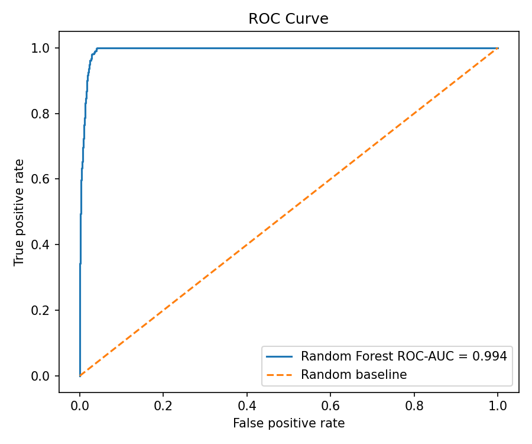
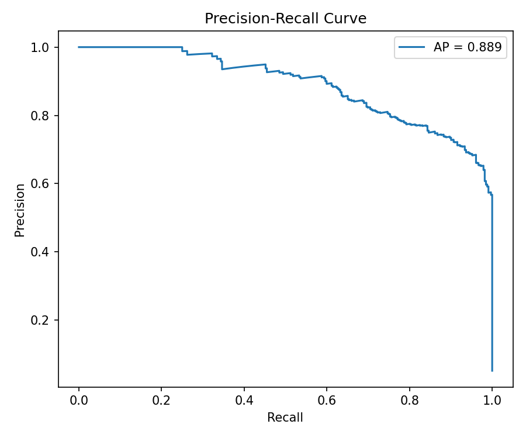
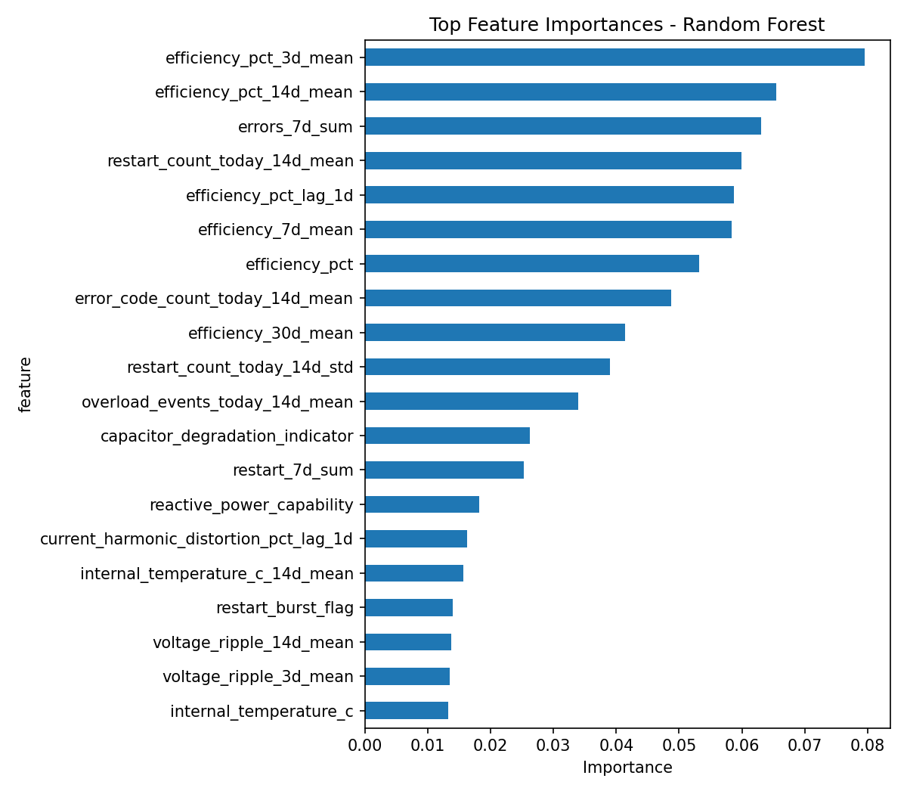
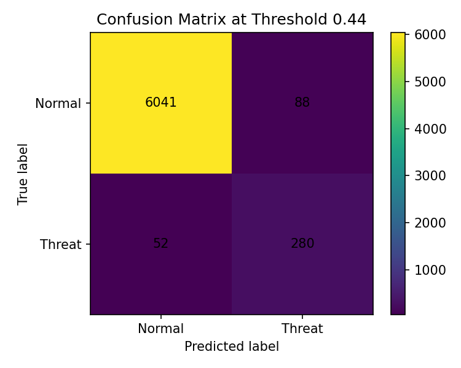

# Cyber-Physical Threat Detection

Detects suspicious **cyber-physical behaviour** in renewable energy assets by finding physical-process anomalies in inverter telemetry that could indicate tampering or unsafe control changes.

## Problem
Attacks on energy infrastructure often show up as unusual physical behaviour (restart bursts, electrical instability, sudden control-like shifts) before they appear in IT logs.

## Approach
1. Engineered physical-process anomaly, event-burst, electrical instability and unsafe control-shift features.
2. Created weak threat labels from high-risk telemetry patterns (to be replaced by real incident labels in production).
3. Trained and compared **Decision Tree, Random Forest and Extra Trees** classifiers, plus an **Isolation Forest** for unsupervised anomaly scoring.
4. Fused supervised and unsupervised scores and tuned the alert threshold to balance recall and false positives.

The current data has no network, SCADA command or access logs, so this prototype builds the physical-process layer. The design shows how those cyber signals would be fused in.

## Results (test period)
| Model | ROC-AUC | Avg Precision | Recall | F1 | False Positive Rate |
|---|---|---|---|---|---|
| Random Forest | 0.994 | 0.889 | 0.79 | 0.79 | 1.2% |
| **Extra Trees** | **0.993** | **0.907** | **0.89** | **0.81** | **1.6%** |
| Decision Tree | 0.969 | 0.823 | 0.94 | 0.74 | 3.2% |

  
  

  
  

## Tech
Python, pandas, scikit-learn, XGBoost, joblib, Matplotlib

## Files
| File | Description |
|---|---|
| `cyber_physical_threat_detection_prototype.ipynb` | Full prototype notebook |
| `Cyber_Physical_Threat_Detection_Design.pdf` | Design document |
| `outputs/` | Model metrics, feature importance, threshold tuning |
| `images/` | ROC, PR curve, confusion matrix and other plots |
| `data/` | Sample data and data dictionary |

## Note on Data
All data is synthetic and generated for prototyping. Only a sample file and the data dictionary are included here to keep the repository lightweight. The notebook was run on the full synthetic dataset (about 9 MB), which can be regenerated or requested.

[Back to main README](../README.md)
